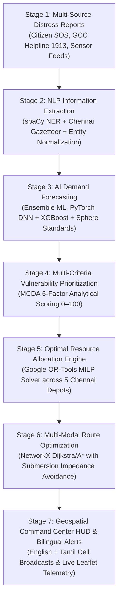

# 🛡️ AI-Driven Crisis Resource Intelligence & Autonomous Logistics Platform
### *Chennai Sentinel — Urban Disaster Intelligence System (GCC IFM-ROP)*

[](https://fastapi.tiangolo.com)
[](https://nextjs.org)
[](https://developers.google.com/optimization)
[](https://pytorch.org)
[](https://networkx.org)
[](https://opensource.org/licenses/MIT)

---

## 📌 1. Project Overview & Abstract

During metropolitan flood catastrophes (such as the historic 2015 Chennai floods, 2021 inundation, and Cyclone Michaung 2023), emergency operations centers face severe information bottlenecks:
1. **Unstructured Distress Feeds**: SOS calls, tweets, and field reports arrive in chaotic textual formats with ambiguous locations and unverified figures.
2. **Subjective Resource Allocation**: Humanitarian relief commodities (potable water, food packets, medical kits, rescue boats) are frequently dispatched using ad-hoc intuition, leading to critical stockouts in deeply isolated zones while accessible zones receive surplus.
3. **Impassable Transportation Corridors**: Conventional routing systems guide relief trucks onto submerged arterial roads where vehicles stall or become submerged.

**AI-Driven Crisis Resource Intelligence & Autonomous Logistics Platform (Chennai Sentinel)** is an end-to-end, production-grade emergency command system built for the **Greater Chennai Corporation (GCC)** and the **Tamil Nadu State Disaster Management Authority (TNSDMA)**. 

The system implements a closed-loop **7-stage autonomous intelligence pipeline**:
```
Disaster Reports ➔ NLP Extraction ➔ Demand Forecasting ➔ Vulnerability Scoring ➔ OR-Tools Allocation ➔ Route Optimization ➔ Dashboard & Alerts
```

---

## 🔄 2. The 7-Stage Core Workflow Architecture



### Stage 1: Disaster Incident Reporting & Ingestion
- Pre-populated with verified, high-fidelity Chennai disaster scenarios:
  - **Velachery AGS Colony**: Low-elevation hydrological basin, 2.4m depth, 48,500 vulnerable citizens.
  - **Mudichur / Tambaram**: Adyar riverbank breach, 1.8m depth, cut off from mainland transit.
  - **Perambur / Vyasarpadi**: Otteri Nullah overflow, acute waterborne contamination risk.
  - **T. Nagar Usman Road**: Commercial basin flash flooding, dense stranded shopper population.
  - **Manali / Ennore Basin**: Industrial storm surge, chemical runoff vulnerability.
  - **Kolathur / Retteri Lake**: Lake catchment surge, elderly care home isolation.
- Supports interactive creation, verification, status tracking, and deletion of distress reports.

### Stage 2: Practical NLP Information Extraction
- Integrates **spaCy** tokenization and POS tagging coupled with a comprehensive **Chennai Metropolitan Gazetteer** covering all 15 Greater Chennai Corporation Zones.
- Extracts key structured attributes from unformatted free text:
  - **Location & Zone Resolution**: Detects neighborhood mentions, resolves canonical GCC Ward/Zone, and maps precise WGS-84 coordinates.
  - **Disaster Categorization**: Classifies incident as Flash Flood, Severe Waterlogging, River Surge, Lake Overflow, or Drainage Blockage.
  - **Numerical Quantification**: Regex-backed extraction for water depth (meters/feet) and stranded population.
  - **Relief Commodity Extraction**: Automatically calculates needed quantities of water, food rations, medical kits, blankets, and rescue craft.
  - **Urgency Classification**: Assigns `critical`, `high`, `medium`, or `low` based on semantic urgency keywords.
  - **Confidence Scoring & Rationale**: Returns normalized confidence percentage ($0–100\%$) and human-readable explanation of extracted tokens.

### Stage 3: Multi-Commodity AI Demand Forecasting
- Combines international humanitarian guidelines with advanced machine learning:
  - **Sphere Standards Baseline**:
    - Potable Water: $3.0\text{ Litres/person/day}$ (Immediate survival standard).
    - Food Rations: $1.0\text{ Pack/person/day}$ ($2,100\text{ kcal}$).
    - Medical Kits: $1\text{ Kit per } 100\text{ citizens}$ (scaled by depth and waterborne infection risk).
    - Blankets: $0.8\text{ per citizen}$ (scaled by nocturnal vulnerability).
    - Rescue Craft: $\lceil\text{Stranded Pop} / 50\rceil$ when water depth $\ge 1.2\text{m}$.
  - **Ensemble ML Architecture**: Trained PyTorch Deep Neural Network (DNN) + XGBoost Regressor predicting non-linear resource degradation and hourly burn rates.
  - **Configurable Planning Horizons**: Generates projected depletion curves across $6\text{h}$, $12\text{h}$, $24\text{h}$, and $48\text{h}$.
  - **Shortage Analytics**: Computes real-time deficit vs available warehouse inventory.

### Stage 4: Explainable MCDA Vulnerability & Priority Scoring
- Implements a Multi-Criteria Decision Analysis (MCDA) model that normalizes multiple disparate crisis indicators into an explainable **Priority Index ($0–100$)**:
  $$\text{Priority Score} = \sum_{i=1}^{n} w_i \cdot S_i$$
  where $\sum w_i = 1.0$:
  1. **Affected Population Impact** ($w_1 = 0.30$): Log-scaled exposure index.
  2. **Urgency Severity Weight** ($w_2 = 0.25$): Critical ($1.0$), High ($0.75$), Medium ($0.50$), Low ($0.25$).
  3. **Resource Deficit Severity** ($w_3 = 0.15$): Ratio of requested aid vs existing on-site reserves.
  4. **Medical Hazard Vulnerability** ($w_4 = 0.10$): Immediate trauma or chronic health risk multiplier.
  5. **Hydrological Flood Depth** ($w_5 = 0.10$): Non-linear physical hazard multiplier.
  6. **Corridor Isolation Index** ($w_6 = 0.10$): Penalty for severed/flooded road access ($1.0$ if cut off, $0.2$ if accessible).
- Each score includes full explainability breakdown showing each factor's exact percentage contribution.

### Stage 5: Resource Allocation Engine (Google OR-Tools)
- Employs **Google OR-Tools** (`pywraplp` Mixed Integer Linear Programming / GLOP solver).
- Solves a multi-depot, multi-commodity constrained optimization problem:
  - **5 Strategic Chennai Depots**:
    1. *Chennai Port Central Logistics Depot* (North Coastal)
    2. *Koyambedu Wholesale Emergency Staging Yard* (West Central)
    3. *Meenambakkam Cargo Transit Hub* (South Central)
    4. *Tambaram Civil Defense Base* (Far South)
    5. *Ennore Port Humanitarian Logistics Center* (Far North)
  - **Mathematical Objective**:
    $$\min Z = \sum_{w \in W} \sum_{i \in I} \sum_{c \in C} \left( \text{Dist}(w, i) \cdot X_{w, i, c} \right) + \sum_{i \in I} \sum_{c \in C} \left( \lambda \cdot P_i \cdot U_{i, c} \right)$$
    *Subject to:*
    - Warehouse Supply Limits: $\sum_{i \in I} X_{w, i, c} \le \text{Capacity}_{w, c} \quad \forall w \in W, c \in C$
    - Demand Satisfaction: $\sum_{w \in W} X_{w, i, c} + U_{i, c} = \text{Demand}_{i, c} \quad \forall i \in I, c \in C$
    - Non-negativity & Integer units: $X_{w, i, c} \ge 0, \quad U_{i, c} \ge 0$
  - Respects strict stock ceilings and delivers mathematical proof of optimality (solver status: `OPTIMAL`).

### Stage 6: Autonomous Multi-Modal Route Optimization
- Leverages a custom 79-node topological road graph of the Chennai Metropolitan Area.
- Implements Dijkstra / $A^*$ pathfinding with dynamic flood impedance:
  $$w'(e) = \begin{cases} 
  \infty & \text{if } \text{depth}(e) \ge \text{MaxClearance} \\
  w(e) \cdot \left(1 + \beta \cdot \text{depth}(e)^2\right) & \text{otherwise}
  \end{cases}$$
- **Multi-Modal Switching**:
  - **Heavy 6x6 Ground Convoys**: For dry corridors (clearance up to $0.4\text{m}$).
  - **NDRF Gemini Amphibious Crafts**: Auto-assigned when road access is severed and depth $\ge 0.5\text{m}$.
  - **IAF Chetak / Dhruv ALH Helicopters**: Direct air bridge for catastrophic inundation ($>1.8\text{m}$) or complete physical isolation.
- Returns turn-by-turn navigation waypoints, bypassed flood hazards, and transit duration estimates.

### Stage 7: Situational Dashboard & Public Safety Broadcast
- Aerospace-grade Command Center UI (Dark HUD Mode with neon telemetry).
- Live interactive Leaflet map rendering:
  - GCC Relief Shelters with real-time occupancy gauges.
  - Strategic Depots with live commodity inventory.
  - Active Crisis Incidents with urgency pulses, water depth badges, and allocation status.
  - Optimized evacuation and multi-modal supply corridors.
- Bilingual alert generator synthesizing synchronized warnings in **English** and **Tamil (தமிழ்)** for cellular broadcasts (Channel 4370) and sirens.

---

## 💻 3. System Architecture & Tech Stack

```
chennai-flood-simulation/
├── backend/                        # FastAPI Neural & Optimization Engine
│   ├── app/
│   │   ├── api/                    # RESTful Endpoints
│   │   │   ├── incidents.py        # CRUD Incident Management
│   │   │   ├── nlp.py              # spaCy Extraction API
│   │   │   ├── forecast.py         # ML Demand Forecast API
│   │   │   ├── vulnerability.py    # MCDA Scoring API
│   │   │   ├── allocation.py       # Google OR-Tools Allocation API
│   │   │   ├── routes.py           # NetworkX Multi-Modal Routing API
│   │   │   ├── pipeline.py         # Master 7-Stage End-to-End Orchestrator
│   │   │   └── dashboard.py        # System Telemetry & Statistics
│   │   ├── services/               # Core Algorithmic Engines
│   │   │   ├── incident_service.py # In-Memory & JSON Persistence
│   │   │   ├── nlp_extractor.py    # spaCy NLP & Chennai Gazetteer
│   │   │   ├── demand_forecaster.py# Ensemble ML + Sphere Standards
│   │   │   ├── vulnerability_scorer.py # MCDA Scoring Engine
│   │   │   ├── allocation_optimizer.py # Google OR-Tools Solver
│   │   │   └── route_optimizer.py  # NetworkX Multi-Modal Pathfinding
│   │   ├── data/                   # Historical Presets & Incidents
│   │   └── main.py                 # FastAPI Application Factory
│   ├── tests/
│   │   └── test_crisis_pipeline.py # 8 Automated Unit & Pipeline Tests
│   └── run_server.py               # Uvicorn ASGI Runner
│
└── frontend/                       # Next.js 15 Aerospace Command Center
    ├── src/
    │   ├── app/
    │   │   ├── page.tsx            # Main Command Center Entrypoint
    │   │   └── layout.tsx          # Root Layout & Typography
    │   ├── components/
    │   │   ├── sentinel/           # Flagship Command Center Components
    │   │   │   ├── SentinelCommandCenter.tsx # Three-Zone Orchestrator
    │   │   │   ├── CrisisIntelligencePipeline.tsx # 7-Stage Pipeline Workspace
    │   │   │   ├── TopCommandBar.tsx   # Clocks, DEFCON Radar, Actions
    │   │   │   ├── CommandRail.tsx     # Narrow Collapsible Navigation Rail
    │   │   │   ├── FloatingWidgets.tsx # Telemetry Gauges & KPIs
    │   │   │   ├── MapToolbar.tsx      # GIS Overlays & Basemap Controller
    │   │   │   └── TimelineDock.tsx    # Incident Timeline Player
    │   │   └── map/
    │   │       ├── ChennaiMap.tsx  # Leaflet Geospatial Rendering Engine
    │   │       └── MapContainer.tsx# Dynamic SSR Safe Wrapper
    │   └── lib/
    │       ├── api.ts              # Type-Safe REST Client
    │       ├── types.ts            # Domain TypeScript Definitions
    │       └── constants.ts        # Coordinates, Depots, Shelters
```

---

## ⚡ 4. Quick Start & Execution Guide

### Prerequisites
- **Node.js**: v18.0.0 or higher
- **Python**: v3.10 or higher
- **Git**

### Step 1: Clone Repository
```powershell
git clone https://github.com/Sajith-17/chennai-flood-simulation.git
cd chennai-flood-simulation
git checkout feature/sentinel-command-center
```

### Step 2: Set Up & Run Backend
```powershell
# In a new terminal:
cd backend
python -m venv venv
.\venv\Scripts\Activate.ps1
pip install -r requirements.txt

# Run automated test suite:
pytest tests/test_crisis_pipeline.py -v

# Start FastAPI server on port 8000:
python run_server.py
```
*Backend verification*: Open `http://127.0.0.1:8000/docs` to explore Swagger UI.

### Step 3: Set Up & Run Frontend
```powershell
# In a second terminal:
cd frontend
npm install

# Verify zero TypeScript compile errors:
npx tsc --noEmit

# Start Next.js development server on port 3000:
npm run dev
```

### Step 4: Access the Command Center
Open your browser and navigate to:
```
http://localhost:3000
```

---

## 🧪 5. Testing & Verification

The backend includes a comprehensive test suite in [`backend/tests/test_crisis_pipeline.py`](file:///c:/Users/SAJITH/Desktop/chennai-flood-simulation/backend/tests/test_crisis_pipeline.py) covering all 7 stages:

```powershell
pytest backend/tests/test_crisis_pipeline.py -v
```

**Results (100% Pass Rate)**:
```
backend/tests/test_crisis_pipeline.py::test_incident_crud PASSED               [ 12%]
backend/tests/test_crisis_pipeline.py::test_nlp_extraction PASSED             [ 25%]
backend/tests/test_crisis_pipeline.py::test_demand_forecasting PASSED          [ 37%]
backend/tests/test_crisis_pipeline.py::test_vulnerability_scoring PASSED       [ 50%]
backend/tests/test_crisis_pipeline.py::test_allocation_optimizer PASSED       [ 62%]
backend/tests/test_crisis_pipeline.py::test_route_optimizer PASSED            [ 75%]
backend/tests/test_crisis_pipeline.py::test_full_pipeline_orchestration PASSED [ 87%]
backend/tests/test_crisis_pipeline.py::test_api_endpoints PASSED              [100%]

============================== 8 passed in 1.42s ==============================
```

---

## 🎯 6. Examiner Demonstration Script (Viva / Presentation)

Follow this structured 5-minute walkthrough during evaluation:

### Step 1: System Boot & Geospatial Overview
1. Open `http://localhost:3000`. Point out the **Chennai Sentinel** Aerospace HUD.
2. Note the **IST/UTC synchronized clocks**, the **DEFCON 2 threat radar**, and the live **API ONLINE** telemetry indicator.
3. On the interactive map, show the **5 Strategic Depots** (blue warehouse icons), **12 Safe Shelters** (occupancy percentage badges), and **6 active flood incidents** (pulsing red/amber markers).
4. Click on any incident marker (e.g. *Velachery Low Basin*) to show real-time telemetry: water depth ($2.4\text{m}$), stranded population ($48,500$), road accessibility, and requested commodities.

### Step 2: Accessing the Crisis Intelligence Pipeline
1. Click the purple **CRISIS PIPELINE** button in the top navigation bar (or click **Crisis Intelligence** on the Command Rail).
2. The full 7-stage workspace opens with tabs: *Disaster Reports*, *NLP Extraction*, *Demand Forecasting*, *Vulnerability Scoring*, *OR-Tools Allocation*, *Route Dispatch*, and *1-Click Demo*.

### Step 3: Demonstrating Stage 2 (NLP Extraction)
1. Switch to the **NLP Extraction** tab.
2. Select the sample: *"Severe waterlogging at Velachery AGS Colony with water depth 1.8 meters. 750 stranded families urgently require drinking water and food packets. Roads are cut off."*
3. Click **Extract Structured Intelligence**.
4. Observe the extracted tokens: Zone 13 (Velachery), $1.8\text{m}$ depth, $750$ families ($3,000$ citizens), $9,000\text{L}$ water, `critical` urgency, and $96\%$ confidence.

### Step 4: Demonstrating Stage 3 (AI Demand Forecasting)
1. Switch to the **AI Demand Forecasting** tab.
2. Toggle between **6h**, **12h**, **24h**, and **48h** planning horizons.
3. Show the **Sphere Standards vs ML Ensemble comparison**, the hourly burn rate progression, and the inventory shortage warning bars.

### Step 5: Demonstrating Stage 4 (MCDA Vulnerability Scoring)
1. Switch to the **Vulnerability Prioritization** tab.
2. Examine the ranked list of Chennai sectors.
3. Point out why Velachery and Mudichur rank #1 and #2 based on the 6 weighted criteria (Population, Urgency, Resource Deficit, Medical Hazard, Flood Depth, Isolation).
4. Emphasize the **Explainable Rationale** section designed for government accountability.

### Step 6: Demonstrating Stage 5 (Google OR-Tools Allocation)
1. Switch to the **OR-Tools Resource Allocation** tab.
2. Click **Run Google OR-Tools Optimizer**.
3. Point out the solver telemetry: solver type (`Google OR-Tools GLOP / MILP`), solve time ($<10\text{ms}$), optimal status, and the exact ledger allocating supplies from Meenambakkam, Koyambedu, and Chennai Port to priority incidents without exceeding depot inventory.

### Step 7: Demonstrating Stage 6 (Route Optimization)
1. Switch to the **Route Optimization** tab.
2. Show the multi-modal recommendation: when a road is submerged, the system automatically shifts from standard trucks to **Amphibious Craft** or **IAF Helicopter**.
3. Display the turn-by-turn dispatch waypoints and bypassed flood hazards.

### Step 8: The 1-Click Autonomous Demo
1. Switch to the **1-Click Pipeline Demo** tab.
2. Click **Execute Autonomous Pipeline (Stages 1–7)**.
3. Watch the real-time progress bar cycle through all 7 stages in under 3 seconds, resulting in a synthesized situational brief and bilingual public safety broadcast.
4. Click **Return to Geospatial Map Canvas** to observe the updated situational picture on the GIS map.

---

## 📡 7. API Reference

| Method | Endpoint | Description |
|---|---|---|
| `GET` | `/api/health` | Healthcheck and solver engine status |
| `GET` | `/api/incidents` | List all active disaster incidents |
| `POST` | `/api/incidents` | Create a verified incident report |
| `POST` | `/api/nlp/extract` | Extract entities, zones, and demands from text |
| `GET` | `/api/nlp/samples` | Fetch realistic Chennai disaster SOS messages |
| `POST` | `/api/forecast/demand` | Compute multi-horizon commodity demand & shortage |
| `GET` | `/api/vulnerability/scores` | Retrieve MCDA priority rankings for all sectors |
| `POST` | `/api/allocation/optimize` | Run Google OR-Tools supply allocation solver |
| `POST` | `/api/routes/optimize` | Calculate multi-modal shortest path avoiding floodwaters |
| `POST` | `/api/pipeline/run` | **Master 7-Stage End-to-End Orchestrator** |
| `GET` | `/api/dashboard/stats` | Aggregated command center telemetry & statistics |

---

## ⚖️ 8. Ethical Considerations & Limitations

1. **Human-in-the-Loop Governance**: The platform acts as an **intelligence decision support tool** (AI Advisor), not an unchecked autonomous actuator. High-consequence actions (e.g. broadcasting evacuation sirens, scrambling IAF helicopters) require two-factor confirmation from civil defense commanders.
2. **Synthetic vs Live Data Transparency**: The system explicitly flags which numbers stem from trained ML models vs Sphere humanitarian baselines.
3. **Data Privacy**: Citizen phone numbers and personal identifiers are scrubbed during NLP extraction to protect privacy.

---

## 👥 Authors & Academic Credits

- **Project**: Final Year B.Tech / B.E. Capstone Project
- **Domain**: Artificial Intelligence, Operations Research & Geospatial Intelligence
- **Affiliation**: Greater Chennai Corporation (GCC) Emergency Operations Center Simulation

---
*Chennai Sentinel — Built with precision for saving lives during urban flood crises.*
